  
   
  

  
  
  

 

**Senior Web Designer · Core PHP Developer · Computer & Software Engineer**

I build and improve web experiences where **engineering, performance, and visual design** work together. I bring 14+ years of experience across web development, responsive UI/UX, custom PHP platforms, content-driven websites, and front-end optimization, including long-term work with **ALANBA Newspaper in Kuwait**.

- **Backend:** Core PHP, MySQL, REST APIs, JSON, AJAX
- **Frontend:** JavaScript, jQuery, HTML5, CSS3, Bootstrap, responsive design
- **Design:** UI/UX, web and graphic design, cross-browser implementation
- **Platforms & operations:** ASP.NET, WordPress, AWS, hosting, SEO, analytics
- **Education:** B.Sc. in Computer Engineering — AAST, Egypt
- **Based in:** Kuwait

> I care about maintainable code, clear interfaces, reliable delivery, and measurable improvements—not just making a page look good.

## Engineering & design workflow

## Technical toolkit

  
  
  
  
  
  
  
  
  
  

## Selected work

<table>
  <tr>
    <td width="50%" valign="top">
      <h3>🌐 Personal Portfolio</h3>
      
My professional portfolio featuring web design, development work, and selected case studies.

      <a href="https://ihab.habyby.net/">Explore portfolio →</a>
    </td>
    <td width="50%" valign="top">
      <h3>🔗 LHABYBY</h3>
      
A personal link hub for bringing social profiles and online destinations together.

      <a href="https://l.habyby.net/ehabest">Visit LHABYBY →</a>
    </td>
  </tr>
  <tr>
    <td width="50%" valign="top">
      <h3>📱 HABYBY</h3>
      
A web and media project focused on posts, movie ratings, and community reviews.

      <a href="https://habyby.net/">Explore HABYBY →</a>
    </td>
    <td width="50%" valign="top">
      <h3>📰 News publishing & front-end engineering</h3>
      
Professional experience supporting a high-traffic newspaper platform, responsive interfaces, and front-end optimization.

      <a href="https://www.alanba.com.kw/">Visit ALANBA Newspaper →</a>
    </td>
  </tr>
</table>

*For professional work, I share public-facing links and summaries; confidential source code and internal systems are not published here.*

## GitHub at a glance

  
  
   
  

  
  

## Let's connect

  
   
  
  
  
  

