<!-- Header SVG Banner -->

  
  

  

 

<!-- Real-time Profile Views & Followers Badges -->

  
  
  

---

<!-- ========================================== -->
<!-- EXECUTIVE PROFILE HUD / TERMINAL CARD      -->
<!-- ========================================== -->

  

---

<!-- ========================================== -->
<!-- INTERACTIVE SKILL BADGES GRID              -->
<!-- ========================================== -->
<h3 align="center">🛠️ Technical Arsenal & Ecosystem</h3>

  <!-- Backend & DB -->
  
  
  
  
  
   
  <!-- Frontend & UI -->
  
  
  
  
  
  
   
  <!-- Design & Tools -->
  
  
  
  

---

<!-- ========================================== -->
<!-- FEATURED PLATFORMS SHOWCASE CARDS          -->
<!-- ========================================== -->
<h3 align="center">🚀 Featured Live Systems & Projects</h3>

<table align="center" width="100%">
  <tr>
    <td width="33%" align="center" style="background: rgba(15, 23, 42, 0.6); border: 1px solid #1e293b; border-radius: 12px; padding: 20px;">
      <h3>🌐 LHABYBY</h3>
      
Custom PHP platform engineered for personal link aggregation and social profile management.

      
    </td>
    <td width="33%" align="center" style="background: rgba(15, 23, 42, 0.6); border: 1px solid #1e293b; border-radius: 12px; padding: 20px;">
      <h3>📱 HABYBY</h3>
      
PHP media network and mobile app built to share posts, movie ratings, and community reviews.

      
    </td>
    <td width="33%" align="center" style="background: rgba(15, 23, 42, 0.6); border: 1px solid #1e293b; border-radius: 12px; padding: 20px;">
      <h3>📰 Alanba Redesign</h3>
      
Front-end architecture and code re-engineering that slashed page load times by 25% in Kuwait.

      
    </td>
  </tr>
</table>

---

<!-- ========================================== -->
<!-- LIVE GITHUB STATS & METRICS                -->
<!-- ========================================== -->
<h3 align="center">📊 GitHub Activity & Metrics</h3>

  
  

 

  

---

<!-- ========================================== -->
<!-- CONNECT WITH ME SECTION                    -->
<!-- ========================================== -->
<h3 align="center">📬 Connect & Collaborate</h3>

  
  
  
  

<!-- Footer SVG Banner -->

  

  Designed & Engineered with ⚡ by <b>Eng. Ihab Elkady</b>

