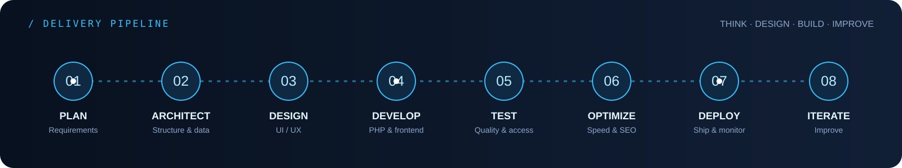

  
   
  

  
  
  

 

**Senior Web Designer · Core PHP Developer · Computer & Software Engineer**

I build and improve web experiences where **engineering, performance, and visual design** work together. I bring 14+ years of experience across web development, responsive UI/UX, custom PHP platforms, content-driven websites, and front-end optimization, including long-term work with **ALANBA Newspaper in Kuwait**.

- **Backend:** Core PHP, MySQL, REST APIs, JSON, AJAX
- **Frontend:** JavaScript, jQuery, HTML5, CSS3, Bootstrap, responsive design
- **Design:** UI/UX, web and graphic design, cross-browser implementation
- **Platforms & operations:** ASP.NET, WordPress, AWS, hosting, SEO, analytics
- **Education:** B.Sc. in Computer Engineering — AAST, Egypt
- **Based in:** Kuwait

> I care about maintainable code, clear interfaces, reliable delivery, and measurable improvements—not just making a page look good.

## Engineering & design workflow

  
  

## 🛠️ Tech Stack & Tools

<table width="100%" border="0" cellpadding="10" cellspacing="0" align="center">
  <tr>
    <td align="center" width="16%">
      
       <b>HTML5</b>
    </td>
    <td align="center" width="16%">
      
       <b>CSS3</b>
    </td>
    <td align="center" width="16%">
      
       <b>PHP</b>
    </td>
    <td align="center" width="16%">
      
       <b>JavaScript</b>
    </td>
    <td align="center" width="16%">
      
       <b>jQuery</b>
    </td>
    <td align="center" width="16%">
      
       <b>AJAX</b>
    </td>
  </tr>
  <tr>
    <td align="center" width="16%">
      
       <b>JSON</b>
    </td>
    <td align="center" width="16%">
      
       <b>XML</b>
    </td>
    <td align="center" width="16%">
      
       <b>ASP.NET</b>
    </td>
    <td align="center" width="16%">
      
       <b>Xcode</b>
    </td>
    <td align="center" width="16%">
      
       <b>Android Studio</b>
    </td>
    <td align="center" width="16%">
      
       <b>Testing</b>
    </td>
  </tr>
  <tr>
    <td align="center" width="16%">
      
       <b>Cross-Browser</b>
    </td>
    <td align="center" width="16%">
      
       <b>UAT</b>
    </td>
    <td align="center" width="16%">
      
       <b>Functional</b>
    </td>
    <td align="center" width="16%">
      
       <b>Performance</b>
    </td>
    <td align="center" width="16%">
      
       <b>Databases</b>
    </td>
    <td align="center" width="16%">
      
       <b>MySQL</b>
    </td>
  </tr>
  <tr>
    <td align="center" width="16%">
      
       <b>WAMP</b>
    </td>
    <td align="center" width="16%">
      
       <b>Web Hosting</b>
    </td>
    <td align="center" width="16%">
      
       <b>CMS</b>
    </td>
    <td align="center" width="16%">
      
       <b>AWS</b>
    </td>
    <td align="center" width="16%">
      
       <b>Wix</b>
    </td>
    <td align="center" width="16%">
      
       <b>Shopify</b>
    </td>
  </tr>
  <tr>
    <td align="center" width="16%">
      
       <b>Design</b>
    </td>
    <td align="center" width="16%">
      
       <b>Photoshop</b>
    </td>
    <td align="center" width="16%">
      
       <b>Filmora</b>
    </td>
    <td align="center" width="16%">
      
       <b>Illustrator</b>
    </td>
    <td align="center" width="16%">
      
       <b>Acrobat</b>
    </td>
    <td align="center" width="16%">
      
       <b>MS Office</b>
    </td>
  </tr>
  <tr>
    <td align="center" width="16%">
      
       <b>UI/UX</b>
    </td>
    <td align="center" width="16%">
      
       <b>Responsive</b>
    </td>
    <td align="center" width="16%">
      
       <b>Logo Design</b>
    </td>
    <td align="center" width="16%">
      
       <b>Frameworks</b>
    </td>
    <td align="center" width="16%">
      
       <b>Bootstrap</b>
    </td>
    <td align="center" width="16%">
      
       <b>Google Analytics & Ads</b>
    </td>
  </tr>
  <tr>
    <td align="center" width="16%">
      
       <b>SEO</b>
    </td>
    <td align="center" width="16%">
      
       <b>adminLTR</b>
    </td>
    <td align="center" width="16%">
      
       <b>TypeScript</b>
    </td>
    <td align="center" width="16%">
      
       <b>SASS</b>
    </td>
    <td align="center" width="16%">
      
       <b>Python</b>
    </td>
    <td align="center" width="16%">
      
       <b>React</b>
    </td>
  </tr>
  <tr>
    <td align="center" width="16%">
      
       <b>Git</b>
    </td>
    <td align="center" width="16%">
      
       <b>Linux</b>
    </td>
    <td align="center" width="16%">
      
       <b>VS Code</b>
    </td>
      <td align="center" width="16%">
      
       <b>Azure</b>
    </td>
    <td align="center" width="16%">
      
       <b>Cloudflare</b>
    </td>
    <td align="center" width="16%">
      
       <b>Social Sharing</b>
    </td>
   
  </tr>

  
</table>

> 💡 **Icons:** Feel free to use my icons API `https://l.habyby.net/logo.php` tester `https://ihab.habyby.net/test.php` (Dedicated repo `https://github.com/ehabest/lhabyby-icons-api`)

## Selected work

<table>
  <tr>
    <td width="50%" valign="top">
      <h3>🌐 Personal Portfolio</h3>
      
My professional portfolio featuring web design, development work, and selected case studies.

      <a href="https://ihab.habyby.net/">Explore portfolio →</a>
    </td>
    <td width="50%" valign="top">
      <h3>🔗 LHABYBY</h3>
      
A personal link hub for bringing social profiles and online destinations together.

      <a href="https://l.habyby.net/ehabest">Visit LHABYBY →</a>
    </td>
  </tr>
  <tr>
    <td width="50%" valign="top">
      <h3>📱 HABYBY</h3>
      
A web and media project focused on posts, movie ratings, and community reviews.

      <a href="https://habyby.net/">Explore HABYBY →</a>
    </td>
    <td width="50%" valign="top">
      <h3>📰 News publishing & front-end engineering</h3>
      
Professional experience supporting a high-traffic newspaper platform, responsive interfaces, and front-end optimization.

      <a href="https://www.alanba.com.kw/">Visit ALANBA Newspaper →</a>
    </td>
  </tr>
</table>

*For professional work, I share public-facing links and summaries; confidential source code and internal systems are not published here.*

## GitHub at a glance

  

   
  

  
  

## Let's connect

  
   
  
  
  
  

---

Thanks for visiting my profile!
If you like my work, consider giving a ⭐ to the repositories you find useful.

